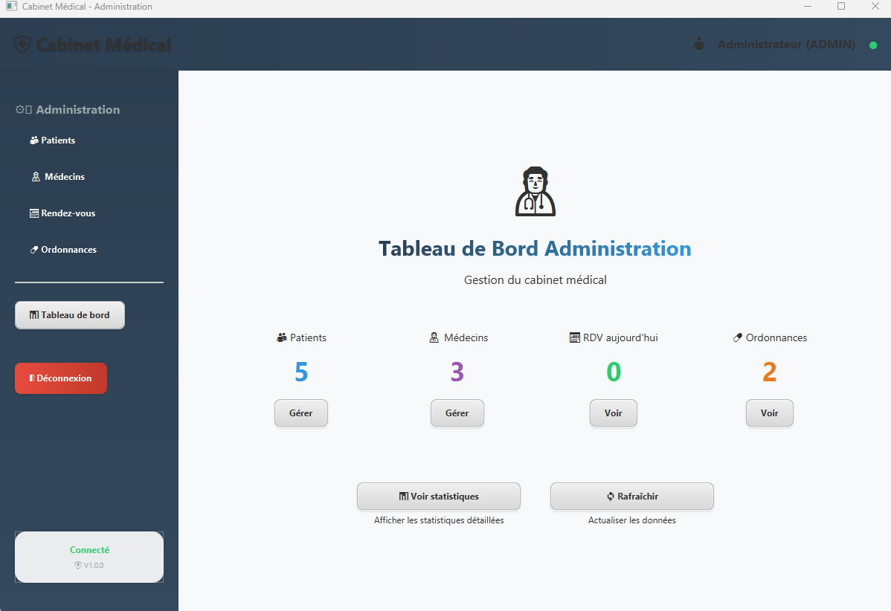
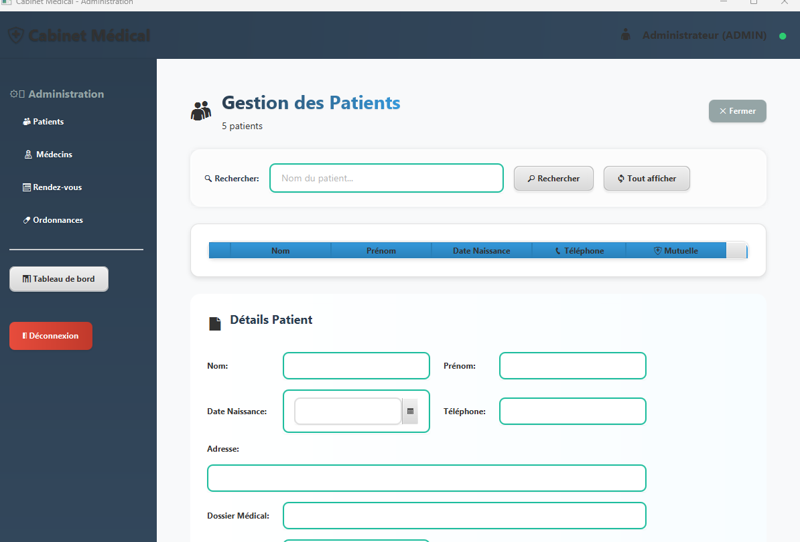
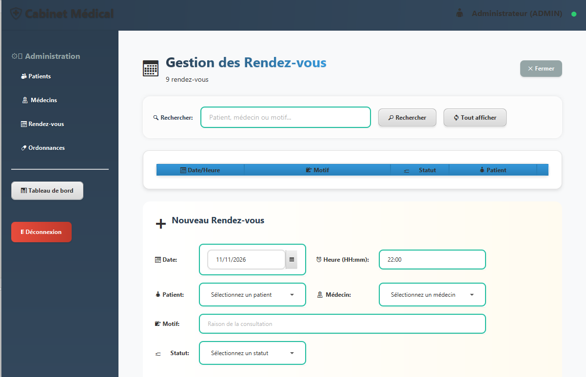

🏥 Medical Clinic Management System

Une application desktop développée en Java pour faciliter la gestion quotidienne d'un cabinet médical. Elle permet de centraliser les informations des patients, de gérer les rendez-vous et d'organiser les dossiers médicaux à travers une interface graphique intuitive.

🚀 Fonctionnalités Clés

Gestion des Patients (CRUD) : Ajout, consultation, modification et suppression des informations des patients.

Gestion des Rendez-vous : Organisation et suivi des rendez-vous médicaux.

Gestion des Dossiers Médicaux : Consultation et gestion des informations médicales des patients.

Interface Graphique Intuitive : Développée avec JavaFX pour offrir une expérience utilisateur simple et interactive.

Gestion des Données : Connexion à une base de données MySQL pour assurer le stockage et la persistance des informations.

🛠 Tech Stack

Langage : Java

Interface graphique : JavaFX

Base de données : MySQL

Accès aux données : JDBC

IDE : NetBeans

Architecture : Object-Oriented Programming (OOP)

📋 Prérequis

JDK 17 ou supérieur

JavaFX SDK

MySQL Server

NetBeans IDE

MySQL JDBC Driver

## 📸 Screenshots

### Dashboard

### Patient Management

### Appointment Management
